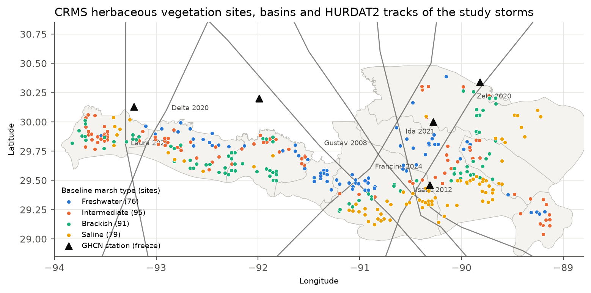
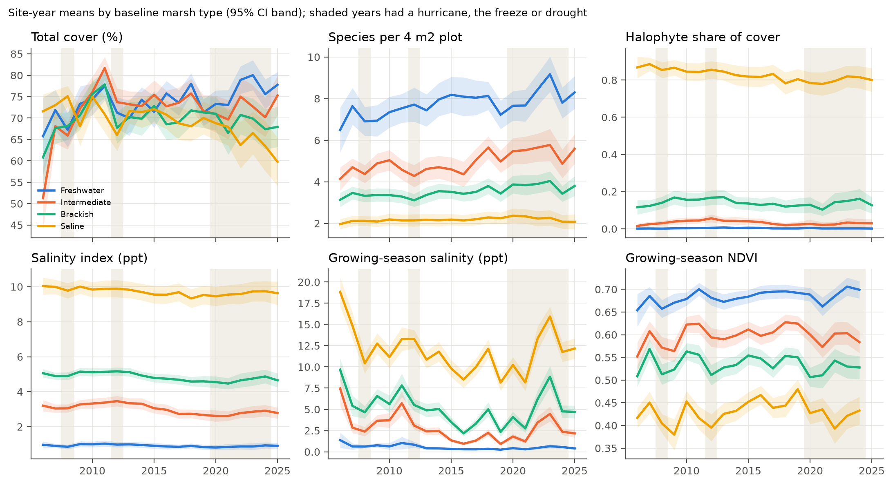
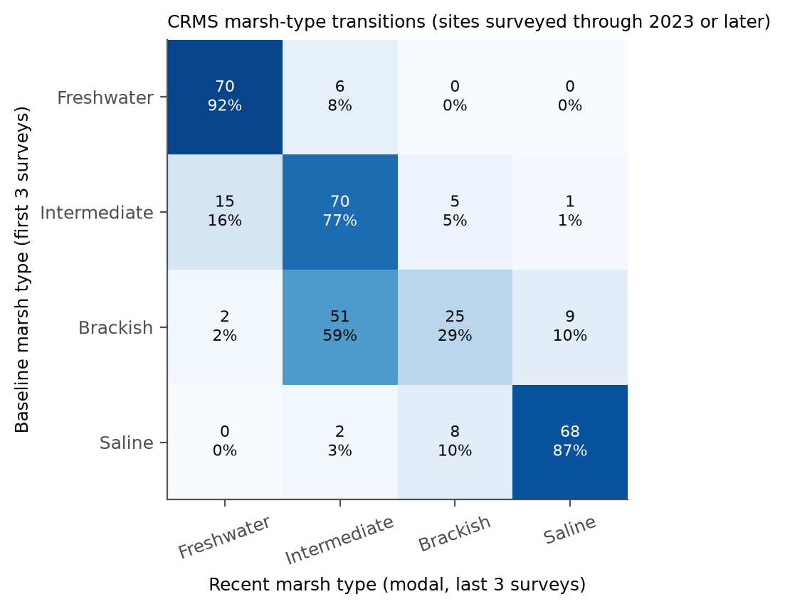
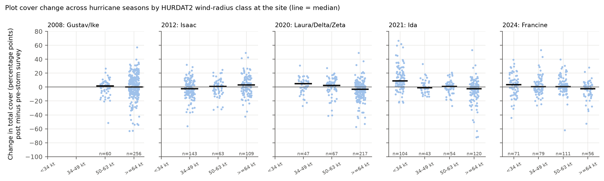
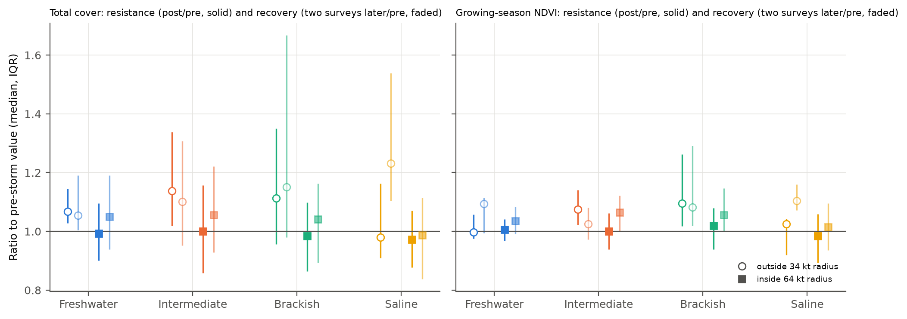
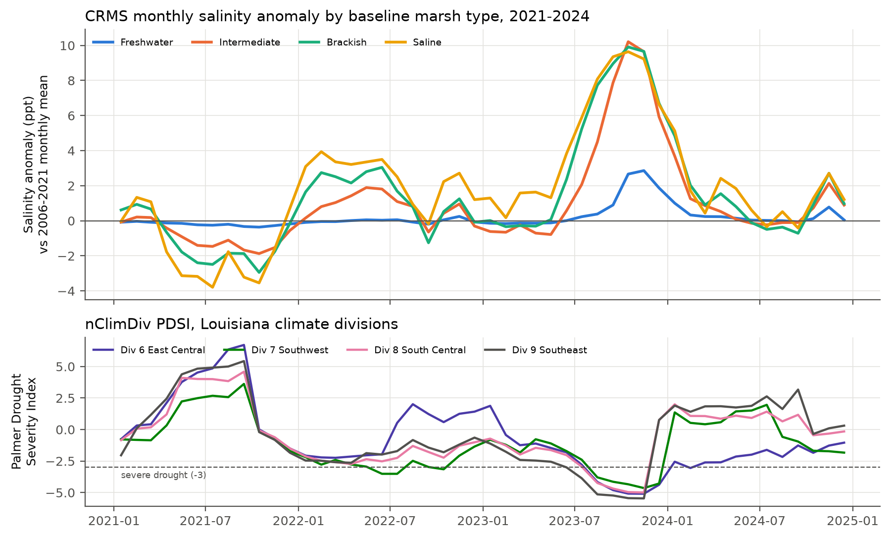
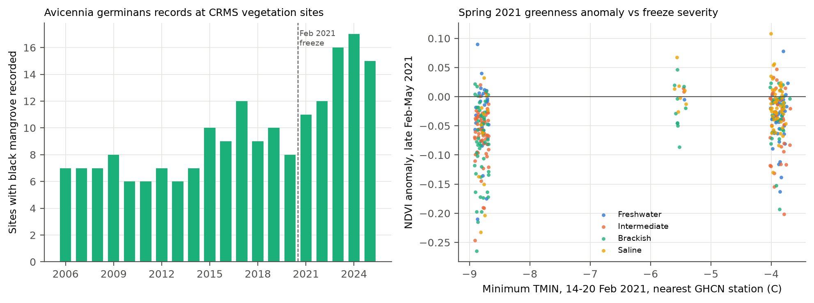
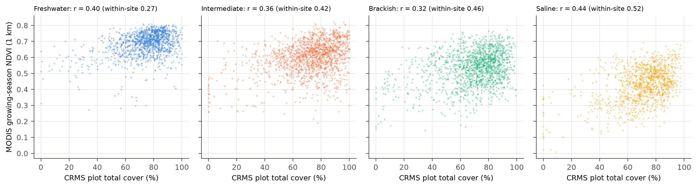
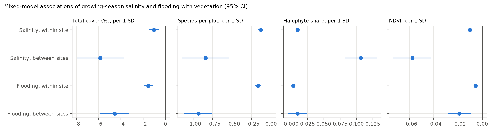
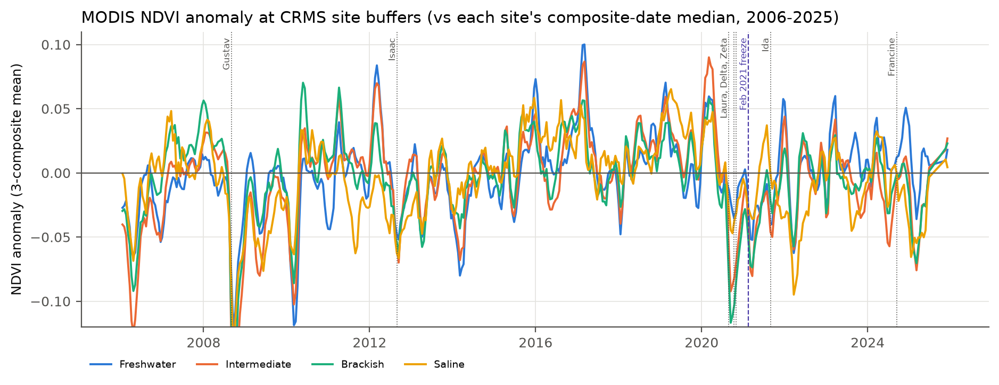

# Coastal Marsh Vegetation and Extreme Events in Louisiana (CRMS, 2006-2025)

**Author:** Anamika Dristi, Ph.D.

This project looks at how Louisiana coastal marsh vegetation changed from 2006 to 2025 and how it responded to hurricanes (Gustav and Ike 2008, Isaac 2012, Laura, Delta and Zeta 2020, Ida 2021, Francine 2024), the February 2021 freeze, and the 2022-2023 drought and salinity spike. It combines Coastwide Reference Monitoring System (CRMS) plot vegetation (64,890 plot visits at 341 herbaceous marsh sites), CRMS hourly salinity and water level, NOAA storm tracks, station temperatures and drought indices, and MODIS NDVI at 1 km site buffers. It uses mixed-effects models with site as a random effect and before-after-control comparisons. The main derived dataset (one row per site and year) is documented with FGDC CSDGM metadata that passes validation against the official FGDC-STD-001-1998 XML schema.

This is an independent analysis of public data. It is separate from the author's LSU dissertation datasets and uses none of that data. All results are associations, not causal effects.

## Why it matters

The work covers the main parts of a landscape ecology postdoc on coastal wetland vegetation:
- wetland vegetation and plant performance: total cover, richness, halophyte share and marsh-type change, by marsh type;
- long-term field data plus remote sensing: 20 years of CRMS plots matched with 449 MODIS NDVI composites;
- historical climate and event data: HURDAT2, GHCN-Daily and nClimDiv;
- spatial and temporal analysis: site-level exposure, mixed models, resistance and recovery;
- FGDC-compliant metadata: CSDGM XML validated against the official XSD (see [docs/METADATA_NOTES.md](docs/METADATA_NOTES.md)).

For context, the author's published work is on Louisiana river and estuary carbon and water quality: Dristi & Xu 2023, *Water* 15(14):2621; Dristi & Xu 2025, *Water* 17(17):2589; and Dristi et al. 2025, *Estuarine, Coastal and Shelf Science* 324:109465.

## Data sources

All sources are public and keyless. All were accessed on 24 October 2026; `scripts/01_download_data.py` writes the exact URLs, file sizes and dates to `raw_data/download_log.json`.

| Source | What was used | Records used here |
|---|---|---|
| CPRA CIMS, [CRMS_Marsh_Vegetation.zip](https://cims.coastal.la.gov/RequestedDownloads/ZippedFiles/CRMS_Marsh_Vegetation.zip) | Species percent cover (Braun-Blanquet) on 4 m2 plots, community, coordinates | 594,288 rows in the export; 467,632 herbaceous marsh rows; 64,890 plot visits; 4,059 plots; 341 sites; 560 species; 2006-2025 |
| CPRA CIMS, [CRMS_Continuous_Hydrographic.zip](https://cims.coastal.la.gov/RequestedDownloads/ZippedFiles/CRMS_Continuous_Hydrographic.zip) (1.3 GB zip, 15 GB CSV) | Hourly salinity and water elevation relative to the marsh surface | 436 recorders at 384 sites; 2,376,856 station-days (18 Feb 2006 to 30 Aug 2026); 6,802 site growing seasons |
| CPRA CIMS, [Basins.zip](https://cims.coastal.louisiana.gov/viewer/metadata/zips/Basins.zip) | Basin polygons, used for the map | 1 layer |
| NOAA NHC [HURDAT2](https://www.nhc.noaa.gov/data/hurdat/) (`hurdat2-1851-2025-092326.txt`) | 6-hourly best tracks, intensity and 34/50/64 kt wind radii | 8 storms, 2008-2024 |
| NOAA NCEI [GHCN-Daily](https://www.ncei.noaa.gov/pub/data/ghcn/daily/by_station/) | Daily TMIN, 14-20 Feb 2021 and winters 2006-2026 | 5 stations: USW00003937 Lake Charles, USW00013976 Lafayette, USC00163433 Galliano, USW00012916 New Orleans (MSY), USW00053865 Slidell |
| NOAA NCEI [nClimDiv](https://www.ncei.noaa.gov/monitoring-content/data/us/climdiv/monthly/current/) (v1.0.0, 20261006 files) | Monthly PDSI, SPI-6 and precipitation; division polygons | Louisiana divisions 6, 7, 8, 9; 2006-2025 |
| NASA LP DAAC MOD13Q1 v061 via [Microsoft Planetary Computer](https://planetarycomputer.microsoft.com/dataset/modis-13Q1-061) (anonymous STAC) | 250 m 16-day NDVI and pixel reliability, small windows only | 1,824 tile items, 449 composites (2006 to Dec 2025), 3,648 window reads, 0 failed |
| FGDC [CSDGM XML schema](https://www.fgdc.gov/schemas/metadata/) | fgdc-std-001-1998.xsd plus 10 section files | used to validate the metadata |

The Houma Terrebonne airport station (USW00012927) was replaced with Galliano because its GHCN record starts in 2025. One CRMS site (CRMS0184, 1 site-year) has no coordinates in the export and was dropped. The Planetary Computer catalog had only 15 MOD13Q1 composites for 2025 (gap from late June to mid November), so 2025 growing-season NDVI is left blank.

**Floristic Quality Index (FQI).** The posting mentions FQI, but CIMS does not offer site FQI as a keyless download, and the species coefficient of conservatism (CC) list is published on lacoast.gov, which returned HTTP 502 on every try during this build. No USGS ScienceBase data release with the CC list turned up either. FQI was therefore **not** computed. Two composition measures are used in its place: the halophyte share of cover, and a salinity index from species composition (see Methods). Once the CC list is available, `scripts/03_vegetation_site_year.py` is where FQI would be added (cover-weighted CC, Cretini et al. 2012).

## Methods

1. **Vegetation (step 3).** Kept herbaceous marsh plots (station IDs with `-V`) in the Freshwater, Intermediate, Brackish and Saline communities, 2006-2025. Swamp and forested stations are excluded. For each plot visit: total cover, species richness inside the plot, and halophyte share of summed species cover. Halophytes: *Spartina (Sporobolus) alterniflora, Distichlis spicata, Juncus roemerianus, Avicennia germinans, Batis maritima, Salicornia, Sarcocornia, Lycium carolinianum, Borrichia frutescens, Sesuvium, Limonium, Suaeda*. Cover code "<1" = 0.5% and "Solitary" = 0.1%. Plots were averaged to site-years (6,439 site-years). Black mangrove presence counts records in or next to a plot.
2. **Baseline marsh type.** The modal CRMS community in each site's first three survey years: 76 Freshwater, 95 Intermediate, 91 Brackish and 79 Saline sites. The recent type is the mode of the last three surveys.
3. **Hydrology (steps 2 and 4).** The 15 GB hourly CSV was streamed with `unzip -p | awk` to station-day means (12 or more valid hours). Growing season = April-September, with 90 or more valid days required. Variables: mean and 95th percentile salinity, percent of hours with water above the marsh surface (flooding duration), and mean water level relative to the marsh.
4. **Salinity index (step 7).** Each species' salinity optimum is its cover-weighted mean of site growing-season salinity over all plot visits (weighted averaging; 224 species with 20 or more visits). The plot index is the cover-weighted mean optimum of the species present. It shows composition on a salinity scale. Because it is calibrated on the same salinity data, it is not used as a response to salinity.
5. **Event exposure (step 5).** HURDAT2 tracks were interpolated to 30 minutes. For each site and storm: closest-approach distance, the highest wind-radius class (34, 50 or 64 kt) whose radius in the site's quadrant reached the site, and a rough wind proxy, Vmax x min(1, (40 km / distance)^0.5). Freeze exposure is the lowest TMIN on 14-20 Feb 2021 at the nearest of the 5 GHCN stations (5.7-120 km away). Drought is nClimDiv PDSI, SPI-6 and precipitation for the site's climate division.
6. **MODIS NDVI (step 6).** MOD13Q1 pixels whose centers lie within 1 km of each site, with pixel reliability 0 or 1. Pixels with an all-years June-September median NDVI below 0.2 (mostly open water) were dropped, leaving 17,265 of 19,973 pixels at 332 sites. Growing-season NDVI needs 9 or more April-September composites. NDVI anomaly = composite value minus the site's 2006-2025 median for that composite date.
7. **Trends and drivers (step 8).** Linear mixed models (statsmodels MixedLM, REML) with a random intercept for site. Trend: `y ~ year + (1|site)` for each marsh type. Drivers: salinity and flooding split into within-site (year-to-year) and between-site (site mean) parts, scaled to SD units, plus marsh type.
8. **Event responses (step 9).** Hurricane seasons were treated as events. For each site: the last survey before the season's first storm and the first survey after its last storm, each within 400 days (1,607 site-events). Pooled before-after-control models: `change ~ event + exposure class + (1|site)`, so exposed sites are compared with less exposed or unexposed sites in the same event. Event-by-event OLS was also fitted on the wind proxy. Resistance = post/pre, and recovery = (value two surveys after the first post-storm survey)/pre. Freeze: mangrove records before and after, and spring 2021 NDVI anomaly against station TMIN, adjusted for 2020 hurricane exposure. Drought: monthly salinity anomaly against the site's 2006-2021 monthly mean, and 2021-2023 vegetation change against the 2023 growing-season salinity anomaly.
9. **Metadata (step 11).** CSDGM XML for `data/crms_marsh_site_year.csv`, validated with two XSD validators against the official schema.

## Key findings

All numbers come from the pipeline run on 24 October 2026. They are associations in observational data.

**Long-term change by marsh type (2006-2025; mixed models, slope per decade with 95% CI)**
- Saline marsh lost cover: total cover fell 5.2 points per decade (CI 4.0 to 6.4). Site means went from 73.4% in 2006-2008 to 63.2% in 2023-2025. The halophyte share also fell slightly (0.87 to 0.81; -0.045 per decade).
- Freshwater cover rose 3.3 points per decade (2.2 to 4.3) and intermediate cover rose 2.0 (0.7 to 3.4). Brackish cover showed no clear trend (-0.3, CI -1.5 to 0.9).
- Plot richness increased in every marsh type, most in intermediate (+0.63 species per plot per decade) and freshwater (+0.59).
- The salinity index fell slightly in all four types (for example -0.33 ppt per decade in intermediate). This fits the high salinities right after the 2005 and 2008 hurricanes (fig. 2) rather than steady freshening.
- Marsh-type transitions (fig. 3, 332 sites surveyed through 2023 or later): 51 of 87 baseline brackish sites (61%) were classified intermediate in their last three surveys, and 9 (10%) were saline. Of 91 intermediate sites, 15 (16.5%) became fresh and 6 (6.6%) became saltier. Baseline years (2006-2008) followed hurricanes Katrina, Rita, Gustav and Ike, so part of this shift probably reflects a salty baseline.

**Salinity and flooding (mixed models, per 1 SD, 4,894 site-years at 302 sites)**
- Higher growing-season salinity was associated with lower total cover, both within sites (-1.0 points per 2.5 ppt SD, CI -1.5 to -0.6) and between sites (-5.9 points per 5.1 ppt SD). It was also associated with fewer species and lower NDVI, and with a higher halophyte share (+0.11 between sites).
- Longer flooding was associated with lower cover: -1.5 points within sites per 18.6% SD and -4.6 between sites. It was also associated with lower richness and NDVI. Within-site flooding was negatively associated with cover in every marsh type (-0.07 to -0.10 points per percent of time flooded). The within-site salinity link with cover was clear only in saline marsh (-0.81 points per ppt, CI -1.07 to -0.55).

**Hurricanes (1,607 site-events)**
- Pooled over five seasons, sites inside the 64 kt radius changed in cover by 11.2 points less than sites outside the 34 kt radius in the same event (CI -13.9 to -8.4). This contrast depends heavily on 2021: the "unexposed" sites in western Louisiana were recovering from Laura and Delta and gained 12.6 points. With 2021 excluded, the 64 kt contrast was -4.6 points (CI -8.9 to -0.3).
- Event by event, cover change per 10 kt of wind proxy was -2.3 (Ida 2021), -1.8 (Laura, Delta and Zeta 2020), -1.4 (Gustav and Ike 2008), -0.7 (Francine 2024, CI includes 0) and +1.3 (Isaac 2012).
- Plot richness fell by 0.87 species more at 64 kt sites than at unexposed sites. The NDVI anomaly in the 48 days after the last storm was 0.066 lower (CI 0.052 to 0.080). The mean post-storm NDVI anomaly at 64 kt sites was -0.149 after Gustav and Ike and -0.060 after Ida.
- Resistance and recovery at 64 kt sites (median post/pre cover): 0.97 saline, 0.98 brackish, 0.99 freshwater, 1.00 intermediate. Two surveys later, freshwater, intermediate and brackish medians were 1.04-1.06 (back above pre-storm cover), but saline stayed at 0.99 (IQR 0.84-1.11). Saline marsh was the only type without a median return to pre-storm cover.

**February 2021 freeze**
- The lowest TMIN was -8.8 C at Lake Charles and Lafayette, -5.5 C at Slidell, -3.9 C at Galliano and -3.8 C at MSY. At Lake Charles, only two other winters in 2006-2026 were as cold or colder.
- Black mangrove (*Avicennia germinans*) was recorded at 8 sites in 2020, 11 in 2021 and 15-17 in 2023-2025. Of the 10 sites with records in 2018-2020, 9 still had records in 2021. This plot-based record does not show a loss of mangrove presence after the freeze. Mangrove cover inside plots is small and was not measured for canopy damage.
- Spring 2021 (late February to May) NDVI anomalies averaged -0.045 across 331 sites. Each 1 C warmer TMIN at the nearest station was associated with an anomaly 0.006 higher (CI 0.003 to 0.009), and this barely changed after adjusting for 2020 hurricane exposure. Only five station temperatures are available, and the coldest stations lie in the area hit by Laura and Delta, so this is weak evidence.

**2022-2023 drought and salinity spike**
- PDSI fell below -4 in all four coastal divisions in late 2023 and reached -5.5 in the Southeast division (November 2023) (fig. 6). Monthly salinity anomalies peaked in October 2023 at +10.2 ppt (intermediate), +9.9 (brackish), +9.6 (saline) and +2.9 (freshwater, November).
- From 2021 to 2023, halophyte share rose by 0.027 on average (293 sites). The rise was larger where the 2023 growing-season salinity anomaly was larger: +0.009 per ppt (p < 0.001), and +0.013 per ppt in brackish marsh. NDVI change over the same period was negatively associated with the salinity anomaly (-0.0075 per ppt, r = -0.36). Total cover change showed no clear association (p = 0.10).
- From 2023 to 2025, saline marsh cover fell another 5.6 points (CI 3.4 to 7.9). Other types changed little.

**Satellite greenness vs field cover**
- Growing-season NDVI and plot cover were positively correlated in every marsh type: r = 0.32-0.44 across site-years, and 0.27-0.52 within sites. The within-site link was strongest in saline marsh (0.52) and weakest in freshwater (0.27). The two measures share a signal, but a 250 m NDVI over a 1 km buffer is not a substitute for plot cover.

## Figures












## Limitations

- Observational data: storms, freeze, drought, salinity and flooding overlap in time and space (for example, 2020 storms followed by the 2021 freeze and Ida in the same region), so the effects cannot be fully separated.
- Survey timing varies (May to December), so a "post-storm" survey can come weeks or a year after landfall. Pre and post windows are capped at 400 days.
- Wind exposure comes from best-track radii and a simple decay proxy, not modeled or measured winds. Storm surge and rainfall are not included.
- Freeze temperatures come from five stations, up to 120 km from sites. There is no site-level temperature or mangrove canopy damage data.
- CRMS community classes are assigned from vegetation each year, so marsh-type transitions are partly a re-labeling of composition change, and the early baseline followed major hurricanes.
- No FQI (see Data sources). The halophyte list is a fixed expert list, and the salinity index is calibrated on the same salinity data.
- MODIS pixels (250 m) within 1 km mix marsh, water and other cover. The 0.2 NDVI water screen is a simple rule, and the 2025 MODIS catalog was incomplete.
- Model standard errors do not account for spatial autocorrelation among nearby sites.

## How to run

ArcGIS Pro was not used. Everything was done with open-source Python. `data/crms_veg_sites.csv` (with lat/lon) and `data/crms_veg_sites.geojson` open in ArcGIS Pro (XY Table To Point, or JSON To Features) and in QGIS.

```bash
python -m venv .venv && source .venv/bin/activate
pip install -r requirements.txt
export CMV_RAW_DIR=/path/with/3GB/free     # optional; default ./raw_data
bash scripts/run_all.sh                    # about 1 hour: 1.3 GB download, 15 GB stream, MODIS reads
```

Each step can also be run on its own, for example `python -I scripts/08_trends_and_drivers.py`. Step 2 needs `unzip` and `awk` (macOS, Linux, or WSL on Windows).

## Repository structure

```
data/      crms_marsh_site_year.csv (main derived dataset), crms_veg_sites.csv/.geojson, hurricane_site_events.csv
docs/      METADATA_NOTES.md
metadata/  crms_marsh_site_year_fgdc.xml (FGDC CSDGM), fgdc_validation_report.txt
outputs/   figures/ (10 PNG), tables/ (15 CSV)
scripts/   01-11 numbered pipeline steps, config.py, 02_hydro_daily.awk, run_all.sh
```

## Citation and author

Anamika Dristi, Ph.D. (2026). *Coastal marsh vegetation and extreme events in Louisiana: CRMS, hydrology, MODIS and FGDC metadata, 2006-2025.* GitHub repository: anamikadristi/coastal-marsh-vegetation-extreme-events. Contact: anamikadristi@gmail.com

Please also cite the data providers: Coastal Protection and Restoration Authority of Louisiana (CPRA), CRMS data via CIMS; NOAA National Hurricane Center (HURDAT2); NOAA NCEI (GHCN-Daily, nClimDiv); NASA LP DAAC (MOD13Q1 v061), accessed through Microsoft Planetary Computer. Code is MIT licensed; data keep their source terms.
